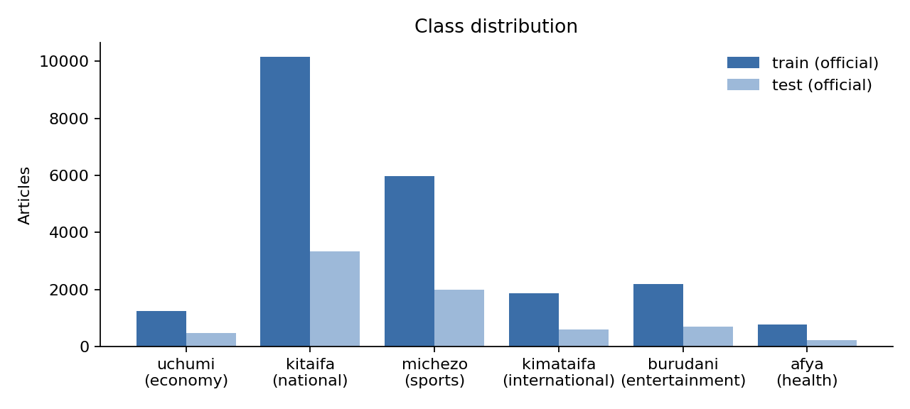
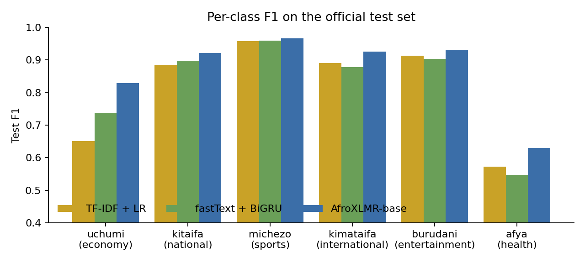
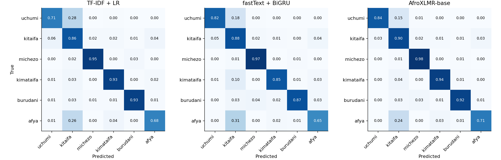
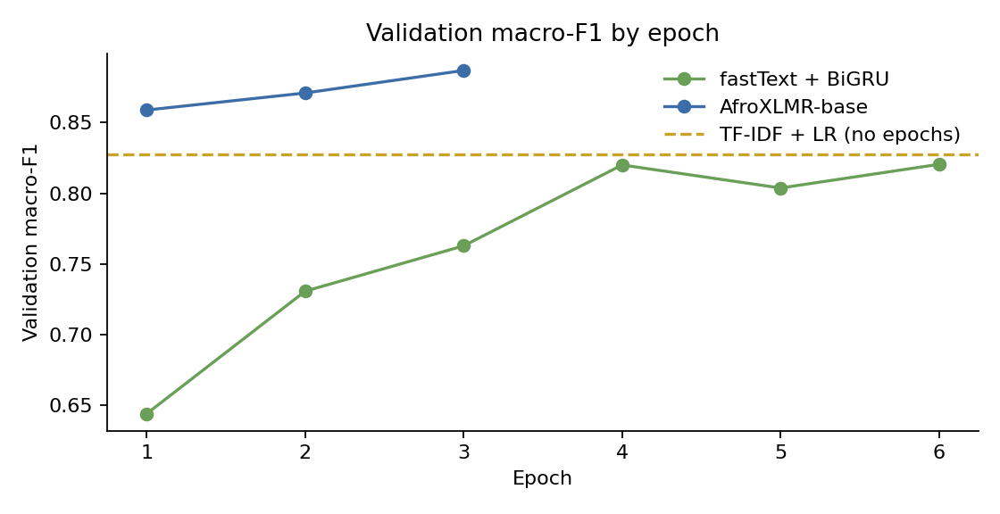

# Topic Classification of Swahili News: A Comparison of TF-IDF, fastText + BiGRU, and AfroXLMR

**Author:** Eldrige
**Repository:** `swahili_txt_classification`

---

## 1. Abstract

This project builds and compares three models that sort Swahili news articles into six topics: *uchumi* (economy), *kitaifa* (national), *michezo* (sports), *kimataifa* (international), *burudani* (entertainment), and *afya* (health). Swahili has more than 200 million speakers (United Nations, n.d.), but it still has far fewer labelled datasets and tools than high-resource languages (Joshi et al., 2020). We use the Swahili News Classification Dataset (David, 2020): 22,207 training and 7,338 test articles from Swahili-language news websites. The classes are highly imbalanced; *kitaifa* covers 46% of articles and *afya* 3.5%. All three models share the same text cleaning, the same stratified validation split, class-balanced loss weights, and checkpoint selection by validation macro-F1. The models are (1) a TF-IDF unigram/bigram logistic-regression baseline, (2) a bidirectional GRU over pretrained Swahili fastText vectors (Grave et al., 2018), and (3) AfroXLMR-base (Alabi et al., 2022), an XLM-RoBERTa model adapted to African languages and fine-tuned for this task. On the official test set, AfroXLMR scores 91.9% accuracy and 0.867 macro-F1. The baseline scores 0.811 macro-F1 and the BiGRU 0.820. AfroXLMR is the best model in every class, and its largest gain is on *uchumi* (+0.18 F1 over the baseline). Error analysis shows that most remaining errors come from overlap between national news and economic or health news, and from gold labels that look wrong. These errors are not simple vocabulary gaps. The best model costs 63 times more storage than the baseline for a 5.6-point gain in macro-F1. The deployed demo therefore uses the smaller models, and the transformer remains an option when more memory is available.

---

## 2. Introduction

### 2.1 Problem

News topic classification assigns each article to one of a fixed set of categories. It is a basic step for news aggregation, search, recommendation, archive organisation, and media monitoring. A working classifier for a language is also a practical test of whether current NLP methods carry over to it. For this reason, topic classification is one of the first benchmarks built for under-resourced languages (Adelani et al., 2023).

### 2.2 Why Swahili

Swahili (Kiswahili) is a Bantu language spoken across East and Central Africa. The United Nations cites more than 200 million speakers, and Kiswahili was the first African language to be given its own UN international day (United Nations, n.d.). Despite this reach, Swahili is still a low-resource language in NLP. Joshi et al. (2020) place most African languages in the classes with little labelled data, and the Masakhane community started largely to close this gap through participatory dataset building (Nekoto et al., 2020).

Swahili also has properties that make it a useful test case. It is agglutinative: subject, tense, object, and relative markers attach to the verb stem, so one stem appears in many surface forms (Hurskainen, 2004). Word-level models therefore meet many rare or unseen forms, and the choice of tokenisation and representation matters.

### 2.3 Objective

The objective is to build a Swahili news topic classifier and to measure how much each step up in model complexity buys. The three steps are a sparse lexical baseline, pretrained static word embeddings with a recurrent encoder, and a pretrained multilingual transformer adapted to African languages. Every model is evaluated under the same protocol. We also aim to explain *where* the models fail, and to deploy a model that a user can try in the browser.

---

## 3. Related Work

**Sparse lexical models.** TF-IDF weighting (Salton & Buckley, 1988) with a linear classifier is a long-standing text classification baseline. With word bigrams it is often hard to beat on topic tasks, where the topic is carried by content words (Wang & Manning, 2012). Linear models over n-gram features are also competitive with neural models at a fraction of the cost (Joulin et al., 2017). For these reasons, we use TF-IDF with logistic regression as the reference point.

**Static embeddings and neural encoders.** Pretrained word vectors let a model share information between related words. fastText vectors use character n-grams, which helps morphologically rich languages (Bojanowski et al., 2017). Grave et al. (2018) released fastText vectors trained on Common Crawl and Wikipedia for 157 languages, Swahili included, and these are the vectors we use. Convolutional (Kim, 2014) and recurrent encoders build document representations on top of such vectors. We use a bidirectional (Schuster & Paliwal, 1997) gated recurrent unit (GRU) (Cho et al., 2014).

**Pretrained transformers for African languages.** Pretrained transformers such as BERT (Devlin et al., 2019) changed the field, and multilingual variants extended it to many languages. XLM-RoBERTa (XLM-R) was trained on CommonCrawl text in 100 languages, including Swahili (Conneau et al., 2020). Low-resource languages are a small share of this data, and multilingual vocabularies split their words into many sub-word pieces, which can hurt downstream performance (Rust et al., 2021). Two responses followed. The first trains smaller models on African-language data only, such as AfriBERTa (Ogueji et al., 2021) and the monolingual SwahBERT (Martin et al., 2022). The second continues pretraining an existing multilingual model on target-language text (Gururangan et al., 2020). AfroXLMR follows the second path. Alabi et al. (2022) applied *multilingual adaptive fine-tuning* (MAFT) to XLM-R on 17 African languages plus English, French, and Arabic, and the result matched or beat XLM-R on African-language benchmarks.

**Swahili and African news classification.** David (2020) released the Swahili news dataset we use, with support from the AI4D language-dataset fellowship. It was the basis of a Zindi hackathon (Zindi, 2021). Martin et al. (2022) report a news-classification F1 of 90.90 for SwahBERT against 89.73 for multilingual BERT. Their public repository does not say which news dataset or split produced this figure (Martin, n.d.), so we do not compare it directly with our numbers. MasakhaNEWS (Adelani et al., 2023) is a news topic benchmark for 16 languages, Swahili among them. Fully supervised fine-tuning reaches about 92.6 average F1 across its languages, and pattern-exploiting training reaches 86.0 F1 from only 10 examples per label.

**Gap addressed.** Earlier work on this dataset mostly reports one model or one leaderboard score. Few studies compare a sparse baseline, static embeddings, and an Africa-adapted transformer under the *same* cleaning, splits, class weighting, and selection rule, or analyse the errors that remain. This project provides that controlled comparison, a per-class and error-level analysis, and a deployable application.

---

## 4. Dataset and Data Preparation

### 4.1 Source and licence

We use the Hugging Face release `community-datasets/swahili_news` of the *Swahili: News Classification Dataset*, version 0.2 (David, 2020). It is licensed CC BY 4.0. The articles were collected from websites that publish news in Swahili (David, 2020). The Zindi challenge page notes that most sources are Tanzanian (Zindi, 2021). The data is loaded with the Hugging Face `datasets` library (Lhoest et al., 2021).

### 4.2 Size and class balance

| Class | Gloss | Train (official) | Share | Test (official) | Share |
|---|---|---:|---:|---:|---:|
| kitaifa | national | 10,155 | 45.7% | 3,348 | 45.6% |
| michezo | sports | 5,970 | 26.9% | 1,996 | 27.2% |
| burudani | entertainment | 2,185 | 9.8% | 703 | 9.6% |
| kimataifa | international | 1,858 | 8.4% | 605 | 8.2% |
| uchumi | economy | 1,260 | 5.7% | 467 | 6.4% |
| afya | health | 779 | 3.5% | 219 | 3.0% |
| **Total** | | **22,207** | | **7,338** | |

*Table 1. Class counts in the official splits.*

*Figure 1. Articles per class in the official train and test splits.*

The largest class is 13 times the size of the smallest. A model that ignored *afya* entirely could still score above 96% accuracy. For this reason, macro-F1 is the main metric, and every model uses class-balanced loss weights (Section 5).

Articles are long. After cleaning, the median training article has 269 words, the mean is 329, and the 95th percentile is about 790 words.

### 4.3 Preprocessing

All three notebooks and the web app use the same cleaning function:

1. lowercase the text;
2. replace URLs and e-mail addresses with a space;
3. replace every character that is not a Latin letter (including accented letters U+00C0 to U+017F), an apostrophe, or whitespace with a space; this removes digits and punctuation;
4. collapse repeated whitespace.

We deliberately did **not** remove stopwords or apply stemming. Swahili meaning is carried by affixes (Hurskainen, 2004), and we had no validated Swahili stemmer or stopword list. Aggressive normalisation risked removing information. TF-IDF already down-weights very frequent words, and the neural models can learn to ignore them.

After cleaning, we removed 1 empty article and 21 duplicates from the training data only, leaving 22,185 articles. The official test set was not changed, so results stay comparable with other work on this split.

### 4.4 Splits

- **Test:** the official test split (7,338 articles), scored once per model after the checkpoint was chosen.
- **Train / validation:** a stratified 90/10 split of the cleaned training set with seed 42, giving 19,966 training and 2,219 validation articles. Class proportions match to three decimal places across train, validation, and test.

### 4.5 Challenges

- **Imbalance.** *afya* has only 779 training articles (Section 4.2).
- **Overlap.** 46 cleaned texts appear in both the training data and the test set. We kept them so the test set stays official; they are 0.6% of the test set, too few to change any comparison.
- **Topic overlap and label noise.** Many *kitaifa* articles are national stories about the economy or health, for example a regional commissioner touring factories or a national institute launching a health survey. These sit between two labels. Section 7 shows that a share of the high-confidence errors have gold labels that look wrong.
- **Length.** Most articles are longer than the 256-token input cap used by the neural models (Section 5).

The dataset fits the task because it is real, topically labelled Swahili news at a scale large enough to train neural models. It is openly licensed, and its official train/test split makes the results reproducible.

---

## 5. Methodology

Every model shares the cleaning and splits above, uses balanced class weights `w_c = N / (K * n_c)` (*N* training articles, *K* = 6 classes, *n_c* articles in class *c*), and selects its final checkpoint by **validation macro-F1**. The test set never influences any choice. The seed is 42 everywhere.

### 5.1 Baseline: TF-IDF + logistic regression

- **Features:** `TfidfVectorizer` with word unigrams and bigrams, `min_df = 2`, at most 200,000 features, and sub-linear term frequency (1 + log tf).
- **Classifier:** multinomial logistic regression with `C = 5.0`, `class_weight = "balanced"`, and up to 1,000 iterations.
- **Implementation:** scikit-learn (Pedregosa et al., 2011). The pipeline is saved with `joblib`.

Size: 1.2 million weights (17.9 MB on disk). Training took 4.0 minutes on a laptop CPU.

### 5.2 fastText + bidirectional GRU

**Vocabulary and embeddings.** The vocabulary is built on the training split only. A word must occur at least twice, and the list is capped at 50,000 types. Of the 49,998 candidate words, 31,745 have a vector in the 300-dimensional Common Crawl Swahili fastText file `cc.sw.300` (Grave et al., 2018). Words without a vector keep their own row only if they occur at least 5 times (13,601 words). Rarer words map to `<unk>`. The final vocabulary has 45,348 entries. On the training text, 92.3% of tokens have a fastText vector and 97.0% are in the vocabulary. Unknown and newly added rows start at the mean fastText vector plus small Gaussian noise (σ = 0.01), so their scale matches the pretrained rows. The `<pad>` row is zero.

**Architecture.** The model has three parts:
- embedding lookup → dropout (0.3);
- one bidirectional GRU layer (Cho et al., 2014; Schuster & Paliwal, 1997) with 128 hidden units per direction over packed sequences;
- the final forward and backward states, concatenated (256 dimensions) → dropout (0.3) → a linear layer with 6 outputs.

Each article is truncated to its first 256 tokens, just under the median length. A news article's opening usually states its topic, and the long tail of longer articles would add much compute for little gain.

**Training.** We use Adam (Kingma & Ba, 2015) with two learning rates: 1e-4 for the embeddings (so the pretrained vectors change slowly) and 1e-3 for the GRU and output layer. The other settings are:
- class-weighted cross-entropy;
- batch size 64;
- gradient-norm clipping at 1.0;
- dropout (Srivastava et al., 2014);
- at most 6 epochs, with early stopping after 2 epochs without validation improvement; the best epoch is restored.

The model has 13.9 million parameters (56.7 MB). Training took 41.6 minutes on an Apple-silicon GPU (PyTorch MPS backend; Paszke et al., 2019).

### 5.3 AfroXLMR-base fine-tuning

**Model.** `Davlan/afro-xlmr-base` (Alabi et al., 2022; Davlan, n.d.) is XLM-R-base (Conneau et al., 2020): 12 layers, hidden size 768, and a SentencePiece sub-word vocabulary. It received continued masked-language-model pretraining (MAFT) on 17 African languages including Swahili. We add a randomly initialised classification head with 6 outputs through Hugging Face Transformers' `AutoModelForSequenceClassification` (Wolf et al., 2020). The full model has 278 million parameters.

**Input.** The input is the same cleaned text, truncated to 256 sub-word pieces. Multilingual tokenisers split a Swahili word into more than one piece on average (Rust et al., 2021), so 256 pieces cover fewer words than the BiGRU's 256-word window.

**Training.** We use AdamW (Loshchilov & Hutter, 2019). The settings are:
- learning rate 2e-5 and weight decay 0.01, with no decay on biases and LayerNorm weights;
- linear warm-up over the first 10% of updates, then linear decay;
- batch size 8 with 2-step gradient accumulation (effective batch 16);
- class-weighted cross-entropy;
- gradient clipping at 1.0;
- fp16 mixed precision and gradient checkpointing to fit a 16 GB Colab T4 GPU;
- at most 3 epochs, with early stopping (patience 2) on validation macro-F1.

The model and tokenizer are saved each time validation macro-F1 improves. This guards against Colab session loss. The best checkpoint is reloaded before the final evaluation. Training took about 28 minutes on the T4.

### 5.4 Evaluation metrics

We report accuracy, macro-averaged precision, recall, and F1 (each class weighted equally), per-class precision, recall, and F1, and row-normalised confusion matrices. Macro-F1 is the main metric because of the class imbalance.

---

## 6. Experiments and Results

### 6.1 Main results

| Model | Val acc. | Val macro-F1 | Test acc. | Test macro-P | Test macro-R | **Test macro-F1** | Parameters | Size (MB) | Train time |
|---|---:|---:|---:|---:|---:|---:|---:|---:|---|
| TF-IDF + LR | 0.889 | 0.827 | 0.880 | 0.788 | 0.843 | **0.811** | 1.2 M | 17.9 | 4.0 min (CPU) |
| fastText + BiGRU | 0.887 | 0.820 | 0.890 | 0.808 | 0.840 | **0.820** | 13.9 M | 56.7 | 41.6 min (MPS) |
| AfroXLMR-base | 0.927 | 0.887 | 0.919 | 0.854 | 0.883 | **0.867** | 278.0 M | 1,129.3 | 28.0 min (T4) |

*Table 2. Validation and official test results. Training times come from different hardware and are not directly comparable.*

AfroXLMR is clearly the strongest model. It improves test macro-F1 by 5.6 points over the baseline and 4.6 points over the BiGRU, and it cuts the test error rate from 12.0% (878 errors) and 11.1% (811) to 8.1% (594). The BiGRU beats the baseline by only 0.9 points of macro-F1 and 1.0 point of accuracy, despite 11 times the parameters and 10 times the training time. On validation, the BiGRU (0.820) is actually below the baseline (0.827). These two models are close to a tie, which matches the view that bigram TF-IDF baselines are strong on topic tasks (Wang & Manning, 2012).

The validation-test gap is small for all models (at most 2.0 points of macro-F1). This suggests the checkpoint selection did not overfit the validation set.

### 6.2 Per-class results

| Class | TF-IDF + LR F1 | BiGRU F1 | AfroXLMR P | AfroXLMR R | AfroXLMR F1 | Support |
|---|---:|---:|---:|---:|---:|---:|
| uchumi (economy) | 0.650 | 0.738 | 0.815 | 0.842 | **0.828** | 467 |
| kitaifa (national) | 0.885 | 0.897 | 0.941 | 0.902 | **0.921** | 3,348 |
| michezo (sports) | 0.958 | 0.959 | 0.953 | 0.980 | **0.966** | 1,996 |
| kimataifa (international) | 0.890 | 0.878 | 0.910 | 0.940 | **0.925** | 605 |
| burudani (entertainment) | 0.912 | 0.903 | 0.938 | 0.923 | **0.930** | 703 |
| afya (health) | 0.573 | 0.548 | 0.565 | 0.712 | **0.630** | 219 |

*Table 3. Per-class test results.*

*Figure 2. Per-class test F1 for each model.*

- **Easy classes.** *michezo* is almost solved by every model (F1 ≥ 0.958). Sports articles use a distinctive vocabulary (*timu*, *mechi*, *ligi*, *bao*), which a bag of n-grams captures as well as a transformer does.
- **Economy gains most.** *uchumi* rises from 0.650 (baseline) to 0.738 (BiGRU) to 0.828 (AfroXLMR). Economic stories share many words with national news (minister, government, region, project). Contextual models separate them better.
- **Health stays hardest.** *afya* is the weakest class for every model, and the BiGRU is the worst of the three on it. The low *precision* (0.565 even for AfroXLMR) shows that the problem is less about missing health articles and more about health-related articles labelled *kitaifa* being predicted as *afya* (Section 7).
- **The BiGRU trades classes.** It is better than the baseline on *uchumi* and *kitaifa* but worse on *kimataifa*, *burudani*, and *afya*. This explains why its macro-F1 gain is small.

### 6.3 Confusion structure

*Figure 3. Row-normalised test confusion matrices (rows are true classes), rebuilt from the saved per-model error files.*

All three models make the same kinds of mistakes, and nearly all of them involve *kitaifa*. The most frequent confusions for AfroXLMR are:

| True → Predicted | TF-IDF + LR | BiGRU | AfroXLMR |
|---|---:|---:|---:|
| kitaifa → afya | 133 | 123 | 110 |
| kitaifa → uchumi | 202 | 173 | 86 |
| kitaifa → michezo | 54 | 71 | 70 |
| uchumi → kitaifa | 133 | 84 | 70 |
| afya → kitaifa | 58 | 67 | 53 |
| kitaifa → kimataifa | 70 | 29 | 42 |

*Table 4. Most frequent test confusions (counts of articles).*

AfroXLMR more than halves the *kitaifa*/*uchumi* confusion in both directions, which is where most of its gain comes from. The *kitaifa*/*afya* confusion falls only slightly. Every model still predicts *kitaifa* for a quarter to a third of true *afya* articles (24% for AfroXLMR).

### 6.4 Training dynamics

*Figure 4. Validation macro-F1 per epoch.*

AfroXLMR reaches 0.859 validation macro-F1 after one epoch, already above the final baseline and BiGRU, and keeps improving to 0.887 at epoch 3. Since the best score came at the last allowed epoch, a longer schedule might help further (Section 9). The BiGRU learns slowly and unevenly: 0.644, 0.731, 0.763, 0.820, 0.804, then 0.820 at epoch 6. It too was still improving at its 6-epoch cap. Its first epochs have high recall but low precision (macro-R 0.81 against macro-P 0.65 at epoch 1). This is the expected effect of strong class weights before the model has learned to separate classes.

---

## 7. Error Analysis and Discussion

### 7.1 Where the models succeed

All models handle articles with strong, topic-specific vocabulary. Examples are sports results and transfers, celebrity and music news (*bongo fleva*, *msanii*), and foreign news that names its place in the dateline (*Nairobi, Kenya*; *Ankara, Uturuki*). For the demo sentence *"Timu ya taifa ya mpira wa miguu imeshinda mechi ya jana usiku"* ("The national football team won last night's match"), the baseline predicts *michezo* with 0.98 probability. The BiGRU also predicts *michezo*, but less confidently (0.69, with 0.31 for *kitaifa*). It is likely influenced by *taifa* ("nation"), a word strongly linked to the *kitaifa* class.

AfroXLMR's gains are clearest when a word's meaning depends on context. Words like *serikali* (government), *waziri* (minister), and *mkoa* (region) appear in both economic and national stories. The bag-of-n-grams baseline counts them the same way in either. The transformer can weigh them against the rest of the article. This is consistent with the benefit of adaptive pretraining on in-language text (Alabi et al., 2022; Gururangan et al., 2020).

### 7.2 What the remaining errors look like

Of AfroXLMR's 594 test errors, 324 (55%) are also misclassified by *both* other models. AfroXLMR fixes 475 of the baseline's errors and introduces 192 new ones. The shared errors are concentrated in the same *kitaifa*-centred pairs as in Table 4. This overlap suggests that a large part of the remaining error comes from the data rather than from any one model.

To test this, we read the 40 highest-confidence AfroXLMR errors (all with predicted probability ≥ 0.99) and gave each one main cause:

| Cause | Count | Example (cleaned text, truncated) |
|---|---:|---|
| Gold label looks wrong; the prediction fits the text | 16 | Labelled *michezo*: "rais … magufuli ametengua uteuzi wa waziri …" (the President revokes a minister's appointment), predicted *kitaifa*. Labelled *kimataifa*: "spika wa bunge job ndugai amesema mbunge wa kigoma mjini …" (Tanzania's Speaker on a Kigoma MP), predicted *kitaifa*. Labelled *burudani*: "ankara uturuki … dola la kiislamu …" (Turkey repatriating IS fighters), predicted *kimataifa*. |
| National vs. economy overlap | 13 | "mkuu wa mkoa wa pwani … anaanza ziara … viwanda" (the Pwani regional commissioner tours factories): gold *kitaifa*, predicted *uchumi*. "waziri mkuu … amezindua kiwanda cha maji" (the Prime Minister opens a water factory): gold *uchumi*, predicted *kitaifa*. |
| National vs. health overlap | 7 | "taasisi ya taifa ya magonjwa ya binadamu nimr … utafiti …" (the national medical research institute plans a study): gold *kitaifa*, predicted *afya*. Several COVID-19 reports have the same pattern. |
| Other two-topic article | 2 | A story about a boxer's former partner (gold *michezo*, predicted *burudani*); a Kenyan MP who is also a musician (gold *kitaifa*, predicted *kimataifa*). |
| Low-content or opinion text | 2 | A list of personal names; an opinion column on gender roles. |

*Table 5. Main causes for the 40 most confident AfroXLMR errors, tagged by hand.*

This is a small, single-annotator sample, so it shows broad patterns rather than exact rates. Still, two findings stand out:

1. **Noisy gold labels set a ceiling.** In 16 of 40 confident errors, the model's answer is arguably more correct than the label. Some errors are clear mislabels, such as an Islamic State repatriation story tagged as entertainment, or a story about Tanzania's Speaker of Parliament tagged as international. Others look like the outlet's section heading rather than the article's topic: several articles labelled *kitaifa* are datelined abroad (New York, Virginia, Nairobi, Kigali) and are predicted *kimataifa*. Northcutt et al. (2021) show that test-set label errors of this kind can change model rankings, so small macro-F1 differences on this test set should be read with caution.
2. **The label set is not mutually exclusive.** *kitaifa* ("national") describes *where* a story happens, while *uchumi* and *afya* describe *what* it is about. A national health story fits both, and the dataset settles the choice in a way the text cannot always predict. This explains the persistent *kitaifa*→*afya* errors and the low *afya* precision. It is a property of the task definition more than a model weakness.

### 7.3 Length and truncation

Error rates by article length (cleaned words):

| Length (words) | Articles | TF-IDF + LR | BiGRU | AfroXLMR |
|---|---:|---:|---:|---:|
| 51–150 | 1,158 | 10.2% | 11.5% | 7.0% |
| 151–300 | 3,217 | 11.8% | 9.5% | 7.3% |
| 301–600 | 2,288 | 13.1% | 12.5% | 8.6% |
| > 600 | 669 | 12.1% | 12.7% | 11.8% |

*Table 6. Test error rate by article length (6 articles with ≤ 50 words omitted).*

AfroXLMR's error rate rises from about 7% on short articles to 11.8% on articles over 600 words. On those long articles its advantage over the baseline almost disappears. This fits the truncation in Section 5.3: 256 sub-word pieces cover only the opening of a long article, while TF-IDF sees the whole text. Long articles are also more likely to cover several topics.

### 7.4 Confidence

The neural models are confidently wrong more often than the baseline. Among their errors, the share with predicted probability ≥ 0.9 is 13.7% for TF-IDF + LR, 39.3% for the BiGRU, and 54.5% for AfroXLMR. The median confidence of an AfroXLMR error is 0.92. Modern neural networks are known to be over-confident without calibration (Guo et al., 2017). The app shows raw probabilities, so users should not read a high score as certainty. Temperature scaling on the validation set would be a cheap fix.

### 7.5 Relation to the literature

Our results match the wider pattern in African-language NLP. Adapted multilingual transformers give the best supervised scores, and strong linear baselines remain hard to beat with static-embedding recurrent models (Adelani et al., 2023; Alabi et al., 2022). Our best macro-F1 (0.867) is below MasakhaNEWS's ~92.6 average supervised F1 (Adelani et al., 2023) and SwahBERT's reported 90.90 (Martin et al., 2022). Those figures use different datasets, label sets, splits, and averaging, so they are context rather than direct comparisons. Our analysis also suggests that the overlapping six-way label scheme and its noisy labels make this dataset harder than its size alone implies.

---

## 8. Deployment

The classifier is served through a web interface built with Gradio (Abid et al., 2019) in `app.py`:

- **Interface.** The user pastes or types Swahili news text, or picks one of three examples. The app shows the six topics with their probabilities, each topic with its English gloss, for example "michezo (sports)".
- **Same preprocessing.** The app applies the `clean_text` function used in training, so production inputs match the training distribution.
- **Model selection.** At start-up the app loads the strongest checkpoint present in `models/`: `swahili_afroxlmr/`, then `swahili_bigru.pt`, then `swahili_baseline.joblib`. The `SWAHILI_MODEL` environment variable can force a choice.
- **Hosting.** The repository has two deployment paths:
  1. a GitHub Actions workflow that deploys to **Azure App Service** (`swahili-txt-classifier`) on every push to `main`;
  2. a `Dockerfile` and `.do/app.yaml` for **DigitalOcean App Platform**. This path builds a small image with only `app.py` and the TF-IDF checkpoint (`SWAHILI_MODEL=baseline`) and serves on port 8080.

  The app listens on `0.0.0.0:$PORT`, so it runs on either platform.

The AfroXLMR checkpoint (1.1 GB) is not committed to the repository, and the deployment requirements do not include `transformers`. The public demo therefore serves the BiGRU or the baseline. With the repository as committed, Azure serves the BiGRU (the first checkpoint present) and DigitalOcean serves the baseline. This is a deliberate trade-off: the baseline scores 0.811 macro-F1, about 94% of AfroXLMR's 0.867, with 1/63 of the storage and fast CPU inference. A larger instance could serve AfroXLMR by adding the checkpoint folder and `transformers`.

*Live demo URL: [to be added]*

---

## 9. Limitations and Future Work

**Data.**
- The labels are noisy and the classes overlap (Section 7.2), which limits the score any model can reach.
- Most sources are Tanzanian (Zindi, 2021), so performance on Kenyan, Ugandan, or Congolese Swahili, or on social-media text, is untested.
- *afya* has only 779 training articles.

Future work could re-annotate the test set, at least the confident errors, in the spirit of Northcutt et al. (2021). Multi-label annotation would also fit the data better, since a story can be both *kitaifa* and *afya*.

**Models and training.**
- Both neural models were still improving at their epoch cap (Section 6.4).
- No hyper-parameter search was run.
- Each model was trained once with one seed, so we report no variance. The BiGRU-versus-baseline gap (0.9 points) is small enough that it may not survive several seeds.
- The shared cleaner lowercases text and removes digits and punctuation. XLM-R was pretrained on raw text, so feeding it original-case text might help it.
- 256 sub-word pieces cover only the start of long articles.

With more compute, the next steps would be: train AfroXLMR longer and on uncased versus raw text; use head-and-tail truncation or chunked inference for long articles; average results over 3 to 5 seeds; and compare AfroXLMR-large, SwahBERT (Martin et al., 2022), and AfriBERTa (Ogueji et al., 2021). Few-shot and prompt-based methods that work well on MasakhaNEWS (Adelani et al., 2023) would show how much of this labelled data is needed.

**Evaluation.**
- Training times were measured on three different machines.
- The error-cause tags come from one annotator and 40 examples.
- No calibration metric (for example, expected calibration error) was reported.

Future work should report confidence intervals (for example, a bootstrap over the test set) and calibrate the models (Guo et al., 2017).

**System.**
- The deployed demo does not serve the best model.
- The app does not detect non-Swahili input.
- The app logs nothing, so drift on new news cannot be monitored.

A quantised or distilled AfroXLMR would make the best model affordable to serve.

---

## 10. Conclusion

We compared three generations of text classifiers on six-way Swahili news topic classification under one controlled protocol. A fine-tuned, Africa-adapted multilingual transformer (AfroXLMR-base) was the clear winner, at 91.9% test accuracy and 0.867 macro-F1. It was best in every class and especially strong on the economy class, where context matters most. Pretrained fastText vectors with a BiGRU barely beat a well-tuned TF-IDF baseline. This confirms that, for topic classification, static embeddings add little over n-grams, while contextual pretraining in the target language adds a lot.

The main lesson of the project is that the remaining errors come mostly from the data. They gather around the *kitaifa* ("national") label, which overlaps with economy and health. A large share of the most confident errors look like labelling mistakes. Improving the label scheme and the test labels is therefore likely to help more than a larger model. A second lesson concerns cost: the 5.6-point macro-F1 gain costs 63 times the storage, which is why the deployed demo uses the smaller models.

---

## 11. References

Abid, A., Abdalla, A., Abid, A., Khan, D., Alfozan, A., & Zou, J. (2019). *Gradio: Hassle-free sharing and testing of ML models in the wild* (arXiv:1906.02569). arXiv. https://arxiv.org/abs/1906.02569

Adelani, D. I., Masiak, M., Azime, I. A., Alabi, J., Tonja, A. L., Mwase, C., Ogundepo, O., et al. (2023). MasakhaNEWS: News topic classification for African languages. In *Proceedings of the 13th International Joint Conference on Natural Language Processing and the 3rd Conference of the Asia-Pacific Chapter of the Association for Computational Linguistics (IJCNLP-AACL 2023)* (pp. 144–159). Association for Computational Linguistics. https://arxiv.org/abs/2304.09972

Alabi, J. O., Adelani, D. I., Mosbach, M., & Klakow, D. (2022). Adapting pre-trained language models to African languages via multilingual adaptive fine-tuning. In *Proceedings of the 29th International Conference on Computational Linguistics* (pp. 4336–4349). International Committee on Computational Linguistics. https://aclanthology.org/2022.coling-1.382

Bojanowski, P., Grave, E., Joulin, A., & Mikolov, T. (2017). Enriching word vectors with subword information. *Transactions of the Association for Computational Linguistics, 5*, 135–146. https://doi.org/10.1162/tacl_a_00051

Cho, K., van Merriënboer, B., Gulcehre, C., Bahdanau, D., Bougares, F., Schwenk, H., & Bengio, Y. (2014). Learning phrase representations using RNN encoder–decoder for statistical machine translation. In *Proceedings of the 2014 Conference on Empirical Methods in Natural Language Processing* (pp. 1724–1734). Association for Computational Linguistics. https://doi.org/10.3115/v1/D14-1179

Conneau, A., Khandelwal, K., Goyal, N., Chaudhary, V., Wenzek, G., Guzmán, F., Grave, E., Ott, M., Zettlemoyer, L., & Stoyanov, V. (2020). Unsupervised cross-lingual representation learning at scale. In *Proceedings of the 58th Annual Meeting of the Association for Computational Linguistics* (pp. 8440–8451). Association for Computational Linguistics. https://doi.org/10.18653/v1/2020.acl-main.747

David, D. (2020). *Swahili: News classification dataset* (Version 0.2) [Data set]. Zenodo. https://doi.org/10.5281/zenodo.5514203

Davlan. (n.d.). *afro-xlmr-base* [Pretrained model]. Hugging Face. Retrieved October 18, 2026, from https://huggingface.co/Davlan/afro-xlmr-base

Devlin, J., Chang, M.-W., Lee, K., & Toutanova, K. (2019). BERT: Pre-training of deep bidirectional transformers for language understanding. In *Proceedings of the 2019 Conference of the North American Chapter of the Association for Computational Linguistics: Human Language Technologies* (pp. 4171–4186). Association for Computational Linguistics. https://doi.org/10.18653/v1/N19-1423

Grave, E., Bojanowski, P., Gupta, P., Joulin, A., & Mikolov, T. (2018). Learning word vectors for 157 languages. In *Proceedings of the Eleventh International Conference on Language Resources and Evaluation (LREC 2018)*. European Language Resources Association. https://aclanthology.org/L18-1550

Guo, C., Pleiss, G., Sun, Y., & Weinberger, K. Q. (2017). On calibration of modern neural networks. In *Proceedings of the 34th International Conference on Machine Learning* (pp. 1321–1330). PMLR.

Gururangan, S., Marasović, A., Swayamdipta, S., Lo, K., Beltagy, I., Downey, D., & Smith, N. A. (2020). Don't stop pretraining: Adapt language models to domains and tasks. In *Proceedings of the 58th Annual Meeting of the Association for Computational Linguistics* (pp. 8342–8360). Association for Computational Linguistics. https://doi.org/10.18653/v1/2020.acl-main.740

Hurskainen, A. (2004). Swahili Language Manager: A storehouse for developing multiple computational applications. *Nordic Journal of African Studies, 13*(3), 363–397.

Joshi, P., Santy, S., Budhiraja, A., Bali, K., & Choudhury, M. (2020). The state and fate of linguistic diversity and inclusion in the NLP world. In *Proceedings of the 58th Annual Meeting of the Association for Computational Linguistics* (pp. 6282–6293). Association for Computational Linguistics. https://doi.org/10.18653/v1/2020.acl-main.560

Joulin, A., Grave, E., Bojanowski, P., & Mikolov, T. (2017). Bag of tricks for efficient text classification. In *Proceedings of the 15th Conference of the European Chapter of the Association for Computational Linguistics: Volume 2, Short Papers* (pp. 427–431). Association for Computational Linguistics. https://aclanthology.org/E17-2068

Kim, Y. (2014). Convolutional neural networks for sentence classification. In *Proceedings of the 2014 Conference on Empirical Methods in Natural Language Processing* (pp. 1746–1751). Association for Computational Linguistics. https://doi.org/10.3115/v1/D14-1181

Kingma, D. P., & Ba, J. (2015). Adam: A method for stochastic optimization. In *3rd International Conference on Learning Representations (ICLR 2015)*. https://arxiv.org/abs/1412.6980

Lhoest, Q., Villanova del Moral, A., Jernite, Y., Thakur, A., von Platen, P., Patil, S., Chaumond, J., et al. (2021). Datasets: A community library for natural language processing. In *Proceedings of the 2021 Conference on Empirical Methods in Natural Language Processing: System Demonstrations* (pp. 175–184). Association for Computational Linguistics. https://doi.org/10.18653/v1/2021.emnlp-demo.21

Loshchilov, I., & Hutter, F. (2019). Decoupled weight decay regularization. In *7th International Conference on Learning Representations (ICLR 2019)*. https://arxiv.org/abs/1711.05101

Martin, G. (n.d.). *SwahBERT* [Computer software]. GitHub. Retrieved October 18, 2026, from https://github.com/gatimartin/SwahBERT

Martin, G., Mswahili, M. E., Jeong, Y.-S., & Woo, J. (2022). SwahBERT: Language model of Swahili. In *Proceedings of the 2022 Conference of the North American Chapter of the Association for Computational Linguistics: Human Language Technologies* (pp. 303–313). Association for Computational Linguistics. https://doi.org/10.18653/v1/2022.naacl-main.23

Nekoto, W., Marivate, V., Matsila, T., Fasubaa, T., Kolawole, T., Fagbohungbe, T., et al. (2020). Participatory research for low-resourced machine translation: A case study in African languages. In *Findings of the Association for Computational Linguistics: EMNLP 2020* (pp. 2144–2160). Association for Computational Linguistics. https://doi.org/10.18653/v1/2020.findings-emnlp.195

Northcutt, C. G., Athalye, A., & Mueller, J. (2021). Pervasive label errors in test sets destabilize machine learning benchmarks. In *Proceedings of the Neural Information Processing Systems Track on Datasets and Benchmarks*. https://arxiv.org/abs/2103.14749

Ogueji, K., Zhu, Y., & Lin, J. (2021). Small data? No problem! Exploring the viability of pretrained multilingual language models for low-resourced languages. In *Proceedings of the 1st Workshop on Multilingual Representation Learning* (pp. 116–126). Association for Computational Linguistics. https://doi.org/10.18653/v1/2021.mrl-1.11

Paszke, A., Gross, S., Massa, F., Lerer, A., Bradbury, J., Chanan, G., et al. (2019). PyTorch: An imperative style, high-performance deep learning library. In *Advances in Neural Information Processing Systems 32* (pp. 8024–8035). Curran Associates.

Pedregosa, F., Varoquaux, G., Gramfort, A., Michel, V., Thirion, B., Grisel, O., et al. (2011). Scikit-learn: Machine learning in Python. *Journal of Machine Learning Research, 12*, 2825–2830.

Rust, P., Pfeiffer, J., Vulić, I., Ruder, S., & Gurevych, I. (2021). How good is your tokenizer? On the monolingual performance of multilingual language models. In *Proceedings of the 59th Annual Meeting of the Association for Computational Linguistics and the 11th International Joint Conference on Natural Language Processing* (pp. 3118–3135). Association for Computational Linguistics. https://doi.org/10.18653/v1/2021.acl-long.243

Salton, G., & Buckley, C. (1988). Term-weighting approaches in automatic text retrieval. *Information Processing & Management, 24*(5), 513–523. https://doi.org/10.1016/0306-4573(88)90021-0

Schuster, M., & Paliwal, K. K. (1997). Bidirectional recurrent neural networks. *IEEE Transactions on Signal Processing, 45*(11), 2673–2681. https://doi.org/10.1109/78.650093

Srivastava, N., Hinton, G., Krizhevsky, A., Sutskever, I., & Salakhutdinov, R. (2014). Dropout: A simple way to prevent neural networks from overfitting. *Journal of Machine Learning Research, 15*, 1929–1958.

United Nations. (n.d.). *Kiswahili Language Day*. Retrieved October 18, 2026, from https://www.un.org/en/node/226143

Wang, S., & Manning, C. D. (2012). Baselines and bigrams: Simple, good sentiment and topic classification. In *Proceedings of the 50th Annual Meeting of the Association for Computational Linguistics (Volume 2: Short Papers)* (pp. 90–94). Association for Computational Linguistics. https://aclanthology.org/P12-2018

Wolf, T., Debut, L., Sanh, V., Chaumond, J., Delangue, C., Moi, A., et al. (2020). Transformers: State-of-the-art natural language processing. In *Proceedings of the 2020 Conference on Empirical Methods in Natural Language Processing: System Demonstrations* (pp. 38–45). Association for Computational Linguistics. https://doi.org/10.18653/v1/2020.emnlp-demos.6

Zindi. (2021). *AI4D Swahili news classification challenge*. Retrieved October 18, 2026, from https://zindi.africa/competitions/ai4d-swahili-news-classification-challenge
